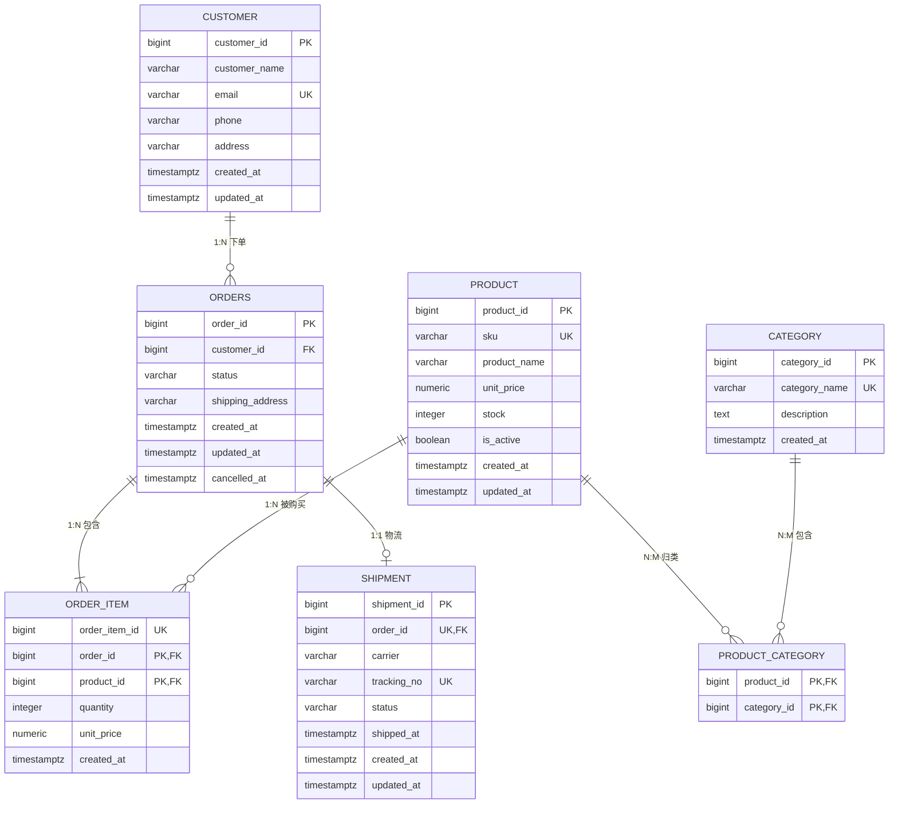

# P1 ERD 与关系模式（02_erd）

> 阶段：P1 需求与 ERD  
> 状态：已实现（待用户实测）  
> 说明：本文件包含 Mermaid ERD、实体属性、联系基数、关系模式、3NF 检查与约束说明；不包含 DDL。

---

## 1. ERD



### 1.1 图例说明

- `||--o{`：左侧 1，右侧 0..N；
- `||--|{`：左侧 1，右侧 1..N；
- `||--o|`：左侧 1，右侧 0..1；
- `product_category` 是 N-M 联系表，不是独立业务实体；
- `access_log` 是运维表，不进入业务 ERD。

---

## 2. 实体属性表

### 2.1 客户 Customer

| 属性 | 类型 | 约束 | 说明 |
|---|---|---|---|
| `customer_id` | BIGINT | PK | 客户编号 |
| `customer_name` | VARCHAR(80) | NOT NULL | 客户姓名 |
| `email` | VARCHAR(160) | NOT NULL, UNIQUE | 邮箱，合成数据 |
| `phone` | VARCHAR(32) | NULL | 手机号，合成数据 |
| `address` | VARCHAR(255) | NULL | 默认收货地址 |
| `created_at` | TIMESTAMPTZ | NOT NULL, DEFAULT NOW() | 注册时间 |
| `updated_at` | TIMESTAMPTZ | NOT NULL, DEFAULT NOW() | 更新时间 |

### 2.2 商品分类 Category

| 属性 | 类型 | 约束 | 说明 |
|---|---|---|---|
| `category_id` | BIGINT | PK | 分类编号 |
| `category_name` | VARCHAR(80) | NOT NULL, UNIQUE | 分类名 |
| `description` | TEXT | NULL | 分类描述 |
| `created_at` | TIMESTAMPTZ | NOT NULL, DEFAULT NOW() | 创建时间 |

### 2.3 商品 Product

| 属性 | 类型 | 约束 | 说明 |
|---|---|---|---|
| `product_id` | BIGINT | PK | 商品编号 |
| `sku` | VARCHAR(64) | NOT NULL, UNIQUE | 商品编码 |
| `product_name` | VARCHAR(160) | NOT NULL | 商品名称 |
| `unit_price` | NUMERIC(12,2) | NOT NULL, CHECK >= 0 | 当前单价 |
| `stock` | INTEGER | NOT NULL, CHECK >= 0 | 当前库存 |
| `is_active` | BOOLEAN | NOT NULL, DEFAULT TRUE | 是否上架 |
| `created_at` | TIMESTAMPTZ | NOT NULL, DEFAULT NOW() | 创建时间 |
| `updated_at` | TIMESTAMPTZ | NOT NULL, DEFAULT NOW() | 更新时间 |

### 2.4 商品—分类 ProductCategory

| 属性 | 类型 | 约束 | 说明 |
|---|---|---|---|
| `product_id` | BIGINT | PK, FK -> `product` | 商品 |
| `category_id` | BIGINT | PK, FK -> `category` | 分类 |

无业务非主属性，纯 N-M 联系表。

### 2.5 订单 Orders

| 属性 | 类型 | 约束 | 说明 |
|---|---|---|---|
| `order_id` | BIGINT | PK | 订单编号 |
| `customer_id` | BIGINT | NOT NULL, FK -> `customer` | 下单客户 |
| `status` | VARCHAR(20) | NOT NULL, CHECK 枚举 | 订单状态 |
| `shipping_address` | VARCHAR(255) | NOT NULL | 下单时收货地址快照 |
| `created_at` | TIMESTAMPTZ | NOT NULL, DEFAULT NOW() | 下单时间 |
| `updated_at` | TIMESTAMPTZ | NOT NULL, DEFAULT NOW() | 更新时间 |
| `cancelled_at` | TIMESTAMPTZ | NULL | 取消时间 |

### 2.6 订单明细 OrderItem

| 属性 | 类型 | 约束 | 说明 |
|---|---|---|---|
| `order_item_id` | BIGINT | NOT NULL, UNIQUE | 供删除接口使用的代理标识，不是主键 |
| `order_id` | BIGINT | PK, FK -> `orders` | 订单 |
| `product_id` | BIGINT | PK, FK -> `product` | 商品 |
| `quantity` | INTEGER | NOT NULL, CHECK > 0 | 数量 |
| `unit_price` | NUMERIC(12,2) | NOT NULL, CHECK >= 0 | 下单时单价快照 |
| `created_at` | TIMESTAMPTZ | NOT NULL, DEFAULT NOW() | 创建时间 |

**主键仍是 `(order_id, product_id)`**。`order_item_id` 只是唯一代理列，用于 `DELETE /api/order-items/<id>`；它不改变主键，也不取代复合主键。同一订单同一商品重复提交时，应用层先合并数量累加，数据库主键作为最终约束。

### 2.7 物流单 Shipment

| 属性 | 类型 | 约束 | 说明 |
|---|---|---|---|
| `shipment_id` | BIGINT | PK | 物流单编号 |
| `order_id` | BIGINT | NOT NULL, UNIQUE, FK -> `orders` | 一个订单最多一张物流单 |
| `carrier` | VARCHAR(80) | NOT NULL | 承运商 |
| `tracking_no` | VARCHAR(80) | NOT NULL, UNIQUE | 运单号 |
| `status` | VARCHAR(20) | NOT NULL, CHECK 枚举 | 物流状态 |
| `shipped_at` | TIMESTAMPTZ | NULL | 发货时间 |
| `created_at` | TIMESTAMPTZ | NOT NULL, DEFAULT NOW() | 创建时间 |
| `updated_at` | TIMESTAMPTZ | NOT NULL, DEFAULT NOW() | 更新时间 |

### 2.8 访问日志 AccessLog（运维表）

| 属性 | 类型 | 约束 | 说明 |
|---|---|---|---|
| `log_id` | BIGINT | PK | 日志编号 |
| `method` | VARCHAR(10) | NOT NULL | HTTP 方法 |
| `path` | VARCHAR(255) | NOT NULL | 请求路径，不含查询参数中的敏感值 |
| `status_code` | INTEGER | NOT NULL, CHECK 100..599 | HTTP 状态码 |
| `duration_ms` | NUMERIC(10,2) | NOT NULL, CHECK >= 0 | 请求耗时 |
| `client_ip` | VARCHAR(64) | NULL | 客户端 IP |
| `created_at` | TIMESTAMPTZ | NOT NULL, DEFAULT NOW() | 记录时间 |

---

## 3. 联系与基数

### 3.1 订单—物流：1-1

- 一个订单最多对应一张物流单；
- 一张物流单只属于一个订单；
- 数据库用 `shipment.order_id UNIQUE NOT NULL` 保证“最多一张”；
- 业务上创建订单时在同一事务内生成物流单，保证“已创建订单有物流单”；
- 取消/退货只改状态，不重复插入物流单；
- 反例：对同一 `order_id` 再插入一条 `shipment`，应触发唯一约束错误。

### 3.2 客户—订单：1-N

- 一个客户可以有多张订单；
- 一张订单只属于一个客户；
- `orders.customer_id NOT NULL` + FK；
- 删除客户时受 `ON DELETE RESTRICT` 限制，避免订单孤儿。

### 3.3 商品—分类：N-M

- 一个商品可以属于多个分类；
- 一个分类可以包含多个商品；
- 通过 `product_category(product_id, category_id)` 复合主键实现；
- `product_id` 外键 `ON DELETE CASCADE`：删除商品时清理联系；
- `category_id` 外键 `ON DELETE RESTRICT`：分类被引用时不能直接删除。

### 3.4 订单—明细：1-N

- 一张订单至少一条明细；
- 一条明细只属于一张订单；
- `order_item.order_id` FK，`ON DELETE CASCADE`；
- 应用层删除明细时至少保留一条。

### 3.5 商品—明细：1-N

- 一个商品可以出现在多条订单明细；
- 一条明细只对应一个商品；
- `order_item.product_id` FK，`ON DELETE RESTRICT`；
- 商品被订单引用时，删除接口返回 409。

---

## 4. 关系模式

```text
customer(customer_id PK, customer_name, email UK, phone, address, created_at, updated_at)

category(category_id PK, category_name UK, description, created_at)

product(product_id PK, sku UK, product_name, unit_price, stock, is_active,
        created_at, updated_at)

product_category(product_id PK/FK -> product,
                 category_id PK/FK -> category)

orders(order_id PK, customer_id FK -> customer, status, shipping_address,
       created_at, updated_at, cancelled_at)

order_item(order_item_id UK, order_id PK/FK -> orders,
           product_id PK/FK -> product, quantity, unit_price, created_at)

shipment(shipment_id PK, order_id UK/FK -> orders, carrier,
         tracking_no UK, status, shipped_at, created_at, updated_at)

access_log(log_id PK, method, path, status_code, duration_ms, client_ip, created_at)
```

### 4.1 主键与外键

| 表 | 主键 | 外键 |
|---|---|---|
| `customer` | `customer_id` | 无 |
| `category` | `category_id` | 无 |
| `product` | `product_id` | 无 |
| `product_category` | `(product_id, category_id)` | `product_id -> product`, `category_id -> category` |
| `orders` | `order_id` | `customer_id -> customer` |
| `order_item` | `(order_id, product_id)` | `order_id -> orders`, `product_id -> product` |
| `shipment` | `shipment_id` | `order_id -> orders`，且 `order_id` 唯一 |
| `access_log` | `log_id` | 无 |

---

## 5. 逐表 3NF 检查

判定标准：

- **1NF**：属性原子，无重复组；
- **2NF**：非主属性完全依赖候选键，不存在部分依赖；
- **3NF**：不存在非主属性对候选键的传递依赖。

| 表 | 候选键 | 非主属性 | 函数依赖 | 部分依赖 | 传递依赖 | 结论 |
|---|---|---|---|---|---|---|
| `customer` | `customer_id`、`email` | `customer_name`、`phone`、`address`、`created_at`、`updated_at` | `customer_id -> 其他`；`email -> customer_id` | 无 | 无 | 3NF |
| `category` | `category_id`、`category_name` | `description`、`created_at` | `category_id -> 其他`；`category_name -> category_id` | 无 | 无 | 3NF |
| `product` | `product_id`、`sku` | `product_name`、`unit_price`、`stock`、`is_active`、`created_at`、`updated_at` | `product_id -> 其他`；`sku -> product_id` | 无 | 无 | 3NF |
| `product_category` | `(product_id, category_id)` | 无 | 无非主属性 | 无 | 无 | 3NF |
| `orders` | `order_id` | `customer_id`、`status`、`shipping_address`、`created_at`、`updated_at`、`cancelled_at` | `order_id -> 其他` | 无 | 无；地址是订单快照，不依赖客户当前地址 | 3NF |
| `order_item` | `(order_id, product_id)`、`order_item_id` | `quantity`、`unit_price`、`created_at` | `(order_id, product_id) -> 其他`；`order_item_id -> (order_id, product_id)` | 无；数量/单价依赖完整组合键 | 无；`unit_price` 是下单快照，不传递依赖 `product.unit_price` | 3NF |
| `shipment` | `shipment_id`、`order_id`、`tracking_no` | `carrier`、`status`、`shipped_at`、`created_at`、`updated_at` | `shipment_id -> 其他`；`order_id -> shipment_id`；`tracking_no -> shipment_id` | 无 | 无 | 3NF |
| `access_log` | `log_id` | `method`、`path`、`status_code`、`duration_ms`、`client_ip`、`created_at` | `log_id -> 其他` | 无 | 无 | 3NF |

### 5.1 关键规范化说明

1. **不存订单总额**：`orders` 不存 `total_amount`，查询时用 `SUM(quantity * unit_price)` 计算，避免派生列与明细不一致。
2. **不存行金额**：`order_item` 不存 `line_amount`，避免 `quantity * unit_price` 冗余。
3. **不存客户姓名/电话到订单**：订单只存 `customer_id`，客户信息通过 join 获取；收货地址是订单快照，属于订单自身属性。
4. **不存分类名到商品**：商品与分类是多对多，分类名只在 `category` 中。
5. **`order_item.unit_price` 是历史快照**：它依赖 `(order_id, product_id)`，不是对 `product.unit_price` 的传递依赖；商品改价不影响历史订单。
6. **`product.stock` 是当前状态**：库存由业务事务维护，不是订单明细的派生汇总列；因此不构成传递依赖。
7. **`shipment.order_id` 唯一**：既表达 1-1，又避免同一订单重复物流单。
8. **无多值属性**：商品的多个分类通过 `product_category` 表表达，符合 1NF。

---

## 6. 约束与删除策略

| 约束 | 落地 | 说明 |
|---|---|---|
| 主键 | 所有表有主键 | 联系表用复合主键 |
| 外键 | 6 个业务外键 + 物流单外键 | 防止孤儿 |
| 唯一 | `customer.email`、`category.category_name`、`product.sku`、`shipment.order_id`、`shipment.tracking_no`、`order_item.order_item_id` | 业务唯一性 |
| 检查 | 价格 >= 0、数量 > 0、库存 >= 0、状态枚举 | 数据库层兜底 |
| 订单删除 | 不提供物理删除订单的常规接口；取消订单保留历史 | 保护订单/物流历史 |
| 明细删除 | 仅 PENDING/PAID，且至少保留一条 | 回补库存 |
| 商品删除 | 被 `order_item` 引用时拒绝 | `ON DELETE RESTRICT` + API 409 |
| 分类删除 | 被 `product_category` 引用时拒绝 | `ON DELETE RESTRICT` |
| 删表演示 | 只删 `demo_drop_me` | 不删核心表 |

---

## 7. 订单详情多表 join 设计

```sql
SELECT o.order_id,
       c.customer_name,
       o.status,
       o.created_at,
       o.shipping_address,
       p.product_name,
       oi.quantity,
       oi.unit_price,
       (oi.quantity * oi.unit_price) AS line_amount,
       s.tracking_no,
       s.status AS shipment_status
FROM orders o
JOIN customer c ON c.customer_id = o.customer_id
JOIN order_item oi ON oi.order_id = o.order_id
JOIN product p ON p.product_id = oi.product_id
LEFT JOIN shipment s ON s.order_id = o.order_id
WHERE o.order_id = %s
ORDER BY oi.order_item_id;
```

说明：

- `JOIN` 连接客户、订单、明细、商品；
- `LEFT JOIN` 物流单，允许尚未生成物流单的历史订单；
- 金额在查询时计算，不依赖冗余列；
- 参数 `%s` 由 psycopg2 传入，禁止字符串拼接。

---

## 8. 商品—分类 N-M 查询设计

```sql
SELECT c.category_id,
       c.category_name,
       COUNT(DISTINCT pc.product_id) AS product_count
FROM category c
LEFT JOIN product_category pc ON pc.category_id = c.category_id
GROUP BY c.category_id, c.category_name
ORDER BY product_count DESC, c.category_id;
```

商品详情中的分类聚合：

```sql
SELECT p.product_id,
       p.product_name,
       COALESCE(string_agg(c.category_name, ', ' ORDER BY c.category_name), '') AS categories
FROM product p
LEFT JOIN product_category pc ON pc.product_id = p.product_id
LEFT JOIN category c ON c.category_id = pc.category_id
WHERE p.product_id = %s
GROUP BY p.product_id, p.product_name;
```

---

## 9. 验收映射

| AC-ID | 对应内容 | 状态 |
|---|---|---|
| AC-DB-01 | 8 张表（7 业务/联系 + 1 运维） | 已实现（待实测） |
| AC-DB-02 | 6 个实体 + 1 张 N-M 联系表 | 已实现（待实测） |
| AC-DB-03 | 1-1、1-N、N-M 基数与约束 | 已实现（待实测） |
| AC-DB-04 | 逐表 3NF 检查 | 已实现（待实测） |
| AC-DB-05 | Mermaid ERD；建模工具导出待补充 | 未开始 |
| AC-DB-06 | 关系模式、主外键说明 | 已实现（待实测） |
| AC-DB-07 | 唯一/检查/外键反例 | 已实现（待实测） |
| AC-CRUD-06 | 订单详情 join | 已实现（待实测） |
| AC-CRUD-07 | 商品—分类 N-M join | 已实现（待实测） |
| AC-TX-01~04 | 订单创建、取消、扣库存事务设计 | 已实现（待实测） |

> 具体运行结果、行数、计划与耗时必须在 Linux VM 上实测，当前不填写任何数字结论。