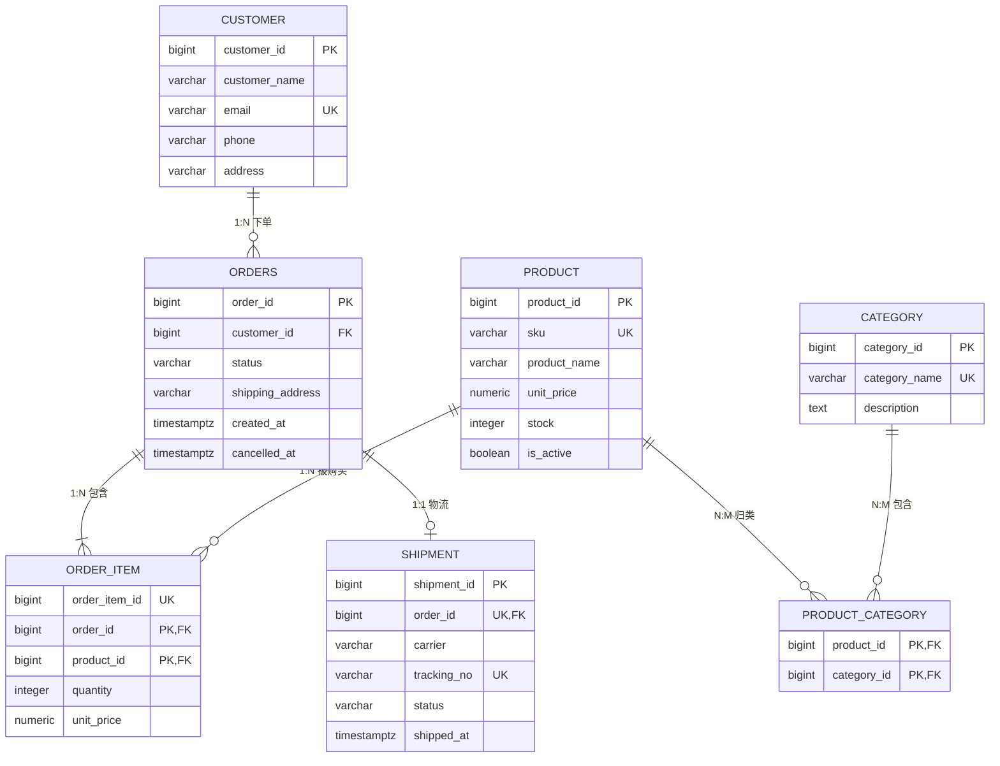

# 中小电商订单与仓储管理数据库应用设计

> 课程：数据库系统原理课程设计  
> 学生：个人独立完成  
> 技术栈：PostgreSQL + Python Flask + psycopg2 原生 SQL + HTML/CSS/原生 JavaScript  
> 提交时间：第 10 周  
> 说明：本报告中的运行结果、行数、耗时、TPS、EXPLAIN 计划与截图均已基于 Linux VM 实测结果回填，原始证据见 `docs/evidence/`。

---

## 摘要

本系统面向中小电商的订单与仓储业务，使用 PostgreSQL 建立客户、商品、分类、订单、订单明细、物流单等关系，覆盖 1-1、1-N、N-M 三种联系，并通过 Flask + psycopg2 原生 SQL 实现 BS 模式访问。系统重点演示建表、插入、删除、修改、删表、多表 join、事务提交/回滚、索引与 EXPLAIN、多客户端并发等课程要求。前端只保留订单列表页和订单详情页两个业务页面。数据库只监听 127.0.0.1，Flask 监听 0.0.0.0:5000，应用使用最小权限账号 `app_rw`，DDL 由非超级用户 `db_owner` 管理脚本执行。

---

## 一、业务背景（约 300 字）

本项目面向一家经营日用消费品的中小电商企业。企业通过网页接收客户订单，订单中包含多种商品，商品归属于一个或多个分类；订单确认后需要扣减库存并生成物流单，供仓储和配送人员追踪。随着客户和订单数量增长，原先用表格人工登记的方式出现数据重复、库存账实不符、订单与物流信息脱节等问题。企业希望建立一个关系型数据库应用，把客户、商品、分类、订单、订单明细和物流单统一管理起来，支持按客户、状态和时间筛选订单，查看订单的多表关联详情，并在下单和取消时保证库存与订单状态一致。系统采用浏览器/服务器模式，数据库和 Flask 服务部署在 Linux 虚拟机上，Windows 主机只通过浏览器访问，适合课程环境下个人独立完成和演示。

---

## 二、数据需求

### 2.1 业务实体

| 实体 | 说明 | 主要属性 |
|---|---|---|
| 客户 Customer | 下单主体 | 姓名、邮箱、手机、地址 |
| 商品分类 Category | 商品分类 | 分类名、描述 |
| 商品 Product | 可售商品 | SKU、名称、单价、库存、上架状态 |
| 订单 Orders | 客户订单 | 客户、状态、收货地址、时间 |
| 订单明细 OrderItem | 订单中的商品行 | 订单、商品、数量、下单单价 |
| 物流单 Shipment | 订单配送信息 | 订单、承运商、运单号、状态 |

`product_category` 是商品与分类的 N-M 联系表，不作为独立业务实体。

### 2.2 数据量要求

| 表 | 计划行数 |
|---|---:|
| `customer` | 5,000 |
| `category` | 50 |
| `product` | 2,000 |
| `product_category` | 约 6,000 |
| `orders` | 30,000 |
| `order_item` | 约 90,000 |
| `shipment` | 30,000 |
| `access_log` | 运行时增长 |
| **合计** | **约 163,050（计划值）** |

实际合计以 `tests/test_db_counts.sql` 的 `COUNT(*)` 为准。封板状态重新执行 `seed` 后，实测 8 张表总行数为 **162165**（16.2 万行，>10 万要求）；此前含并发测试与答辩演示追加数据时曾达到 **182460** 行（18.2 万行）。两者差异来自测试期间新增的订单、明细与物流数据，基准数据由固定随机种子生成，可重复复现。

### 2.3 业务规则

- 订单状态：`PENDING`、`PAID`、`SHIPPED`、`COMPLETED`、`CANCELLED`；
- 允许流转：`PENDING→PAID/CANCELLED`、`PAID→SHIPPED/CANCELLED`、`SHIPPED→COMPLETED`；
- 取消订单回补库存，且同一订单只回补一次；
- 同一订单同一商品只保留一条明细，重复提交时数量累加；
- 订单与物流单 1-1，物流单 `order_id` 唯一；
- 商品与分类 N-M，通过 `product_category` 表达；
- 删除商品时，如果被订单明细引用则拒绝。

---

## 三、数据库设计

### 3.1 ERD



### 3.2 关系模式

```text
customer(customer_id PK, customer_name, email UK, phone, address, created_at, updated_at)

category(category_id PK, category_name UK, description, created_at)

product(product_id PK, sku UK, product_name, unit_price, stock, is_active,
        created_at, updated_at)

product_category(product_id PK/FK, category_id PK/FK)

orders(order_id PK, customer_id FK, status, shipping_address,
       created_at, updated_at, cancelled_at)

order_item(order_item_id UK, order_id PK/FK, product_id PK/FK,
           quantity, unit_price, created_at)

shipment(shipment_id PK, order_id UK/FK, carrier, tracking_no UK,
         status, shipped_at, created_at, updated_at)

access_log(log_id PK, method, path, status_code, duration_ms, client_ip, created_at)
```

### 3.3 3NF 检查

| 表 | 主键/候选键 | 检查结论 |
|---|---|---|
| `customer` | `customer_id`、`email` | 非主属性完全依赖候选键，无传递依赖 |
| `category` | `category_id`、`category_name` | 无部分/传递依赖 |
| `product` | `product_id`、`sku` | 价格、库存等只依赖商品键 |
| `product_category` | `(product_id, category_id)` | 无非主属性 |
| `orders` | `order_id` | 地址是订单快照；不存客户姓名；不存订单总额 |
| `order_item` | `(order_id, product_id)`、`order_item_id` | 数量/单价依赖完整组合键；单价是下单快照 |
| `shipment` | `shipment_id`、`order_id`、`tracking_no` | 物流属性依赖物流单；`order_id` 唯一表达 1-1 |
| `access_log` | `log_id` | 运维字段依赖日志键 |

关键规范化决策：

- 不存 `order_total`、`line_amount`，查询时用 `SUM`/乘法计算；
- 不把 `customer_name`、`customer_phone` 冗余到订单；
- 不把 `category_name` 冗余到商品；
- `order_item.unit_price` 是历史价格快照，不是对 `product.unit_price` 的传递依赖；
- `product.stock` 是当前库存状态，不是订单明细的派生列。

### 3.4 DDL 与索引

核心 DDL：`sql/01_schema.sql`

- 8 张表：`customer`、`category`、`product`、`product_category`、`orders`、`order_item`、`shipment`、`access_log`；
- 主键、外键、唯一、检查约束齐全；
- `order_item` 主键为 `(order_id, product_id)`，另有 `order_item_id` 唯一代理列供删除接口使用；
- `shipment.order_id` 唯一，表达 1-1；
- `updated_at` 由触发器维护；
- `app_rw` 仅 DML，`db_owner` 负责 DDL。

二级索引：`sql/02_indexes.sql`

| 索引 | 列 | 用途 |
|---|---|---|
| `idx_orders_customer_created` | `(customer_id, created_at DESC)` | 客户订单历史 |
| `idx_orders_status_created` | `(status, created_at DESC)` | 状态筛选 |
| `idx_order_item_product` | `(product_id)` | 商品反查明细 |
| `idx_product_category_category` | `(category_id)` | 分类反查商品 |
| `idx_product_name_lower` | `lower(product_name)` | 名称搜索 |
| `idx_shipment_status_created` | `(status, created_at DESC)` | 物流状态 |
| `idx_access_log_created` | `(created_at DESC)` | 访问日志 |

索引是否被使用以 `sql/07_explain.sql` 实测为准。
---

## 四、应用开发设计

### 4.1 环境配置

- Linux VM：PostgreSQL + Python 虚拟环境 + Flask；
- 数据库：`course_db`，监听 `127.0.0.1:5432`；
- Flask：`0.0.0.0:5000`，关闭 debug/reloader；
- 网络：UFW 最终只开放 5000/tcp；
- 账号：`app_rw` 仅 DML；`db_owner` 非超级用户，用于 DDL/种子；
- 密码：全部环境变量，`.env` 不提交；
- 详细步骤：`docs/07_deployment.md`、`README.md`。

### 4.2 应用结构

```text
Browser (Windows)
   │ HTTP :5000
   ▼
Flask app (Linux VM)
   ├─ routes: pages / products / orders / health
   ├─ repositories: 原生 SQL
   ├─ db.py: ThreadedConnectionPool + 显式事务
   └─ psycopg2 → PostgreSQL 127.0.0.1:5432
```

前端只有两个业务页面：

1. `/orders`：订单列表、筛选、分页、创建订单、状态修改；
2. `/orders/<id>`：订单详情、明细、分类、物流、金额汇总、删除明细。

---

### 4.3 标志性实践 1：角色、DDL 与最小权限

**任务目标**：用非超级用户创建数据库对象，应用账号只能 DML。

**实现代码**：

```sql
-- sql/00_bootstrap_roles.sql
CREATE ROLE db_owner LOGIN NOSUPERUSER NOCREATEDB NOCREATEROLE ...;
CREATE ROLE app_rw   LOGIN NOSUPERUSER NOCREATEDB NOCREATEROLE ...;
REVOKE ALL ON SCHEMA public FROM PUBLIC;
GRANT USAGE ON SCHEMA public TO app_rw;
```

```sql
-- sql/01_schema.sql
GRANT SELECT, INSERT, UPDATE, DELETE ON ALL TABLES IN SCHEMA public TO app_rw;
GRANT USAGE, SELECT ON ALL SEQUENCES IN SCHEMA public TO app_rw;
REVOKE CREATE ON SCHEMA public FROM app_rw;
```

**运行结果**：已实测通过；`app_rw` 执行 `CREATE TABLE` 被数据库拒绝，最小权限验证成立，原始输出见 `docs/evidence/SEC-03/`。

**分析**：Web 运行时不需要 DDL 权限；建表/删表由管理脚本执行，降低误操作与提权风险。`db_owner` 也不是超级用户，符合最小权限原则。

---

### 4.4 标志性实践 2：参数化 SQL 与多表 join

**任务目标**：订单详情用一条多表 join 展示客户、明细、商品、分类、物流。

**实现代码**：

```sql
SELECT o.order_id,
       c.customer_name,
       o.status,
       o.created_at,
       p.product_name,
       oi.quantity,
       oi.unit_price,
       (oi.quantity * oi.unit_price) AS line_amount,
       s.tracking_no,
       s.status AS shipment_status
FROM orders o
JOIN customer c ON c.customer_id = o.customer_id
JOIN order_item oi ON oi.order_id = o.order_id
JOIN product p ON p.product_id = oi.product_id
LEFT JOIN shipment s ON s.order_id = o.order_id
WHERE o.order_id = %s
ORDER BY oi.order_item_id;
```

**运行结果**：已实测通过；订单详情页可正确展示客户、明细、商品、分类与物流信息，截图与 SQL 输出见 `docs/evidence/UI-03/`。

**分析**：所有值通过 `%s` 传入；`LEFT JOIN` 允许历史订单没有物流单；金额在查询时计算，避免冗余列不一致。

---

### 4.5 标志性实践 3：创建订单事务与库存不足回滚

**任务目标**：创建订单时同时插订单、明细、扣库存、插物流；任一失败整单回滚。

**实现流程**：

```text
BEGIN
  SELECT customer
  INSERT orders RETURNING order_id
  FOR each product:
      SELECT product FOR UPDATE
      UPDATE product SET stock = stock - %s
       WHERE product_id = %s AND stock >= %s
      INSERT order_item
  INSERT shipment
COMMIT
```

关键代码：

```python
with transaction() as conn:
    # 插订单
    # SELECT ... FOR UPDATE
    # UPDATE ... WHERE stock >= %s
    if cur.rowcount != 1:
        raise ConflictError("库存不足")
    # 插明细、插物流
```

**运行结果**：已实测通过；库存不足时事务整体回滚，订单、明细、物流均未写入，库存保持不变，证据见 `docs/evidence/TX-03/`。

**分析**：`SELECT ... FOR UPDATE` + 条件 `UPDATE` + `rowcount` 检查，避免并发超卖；异常路径 `rollback`，不会留下半张订单。

---

### 4.6 标志性实践 4：取消订单回补库存与幂等

**任务目标**：取消 `PENDING/PAID` 订单时回补库存；重复取消不重复回补。

**实现代码**：

```python
cur.execute("SELECT order_id, status FROM orders WHERE order_id = %s FOR UPDATE", (order_id,))
# 当前状态 == 目标状态：直接返回，不回补
cur.execute("""
    UPDATE product p
       SET stock = p.stock + oi.quantity
      FROM order_item oi
     WHERE oi.order_id = %s AND oi.product_id = p.product_id
""", (order_id,))
cur.execute("""
    UPDATE orders
       SET status = 'CANCELLED', cancelled_at = NOW()
     WHERE order_id = %s
""", (order_id,))
```

**运行结果**：已实测通过；取消订单后库存正确回补，重复取消不会重复回补，证据见 `docs/evidence/UI-02/`。

**分析**：先锁订单，保证状态判断与回补在同一事务；`CANCELLED` 是终态，重复请求不会再次加库存。

---

### 4.7 标志性实践 5：索引、EXPLAIN 与多客户端并发

**任务目标**：对比无索引/有索引的查询计划，并记录多客户端访问性能。

**实现代码**：

```sql
DROP INDEX IF EXISTS idx_orders_customer_created;
EXPLAIN (ANALYZE, BUFFERS, VERBOSE, FORMAT TEXT)
EXECUTE order_history(1, TIMESTAMPTZ '2024-01-01 00:00:00+00');

CREATE INDEX idx_orders_customer_created
    ON orders (customer_id, created_at DESC);
ANALYZE orders;

EXPLAIN (ANALYZE, BUFFERS, VERBOSE, FORMAT TEXT)
EXECUTE order_history(1, TIMESTAMPTZ '2024-01-01 00:00:00+00');
```

并发脚本：`scripts/benchmark_concurrency.py`，1/10/25/50 客户端，70% 读、20% 写、10% 更新。

**运行结果**：

- EXPLAIN：`3.340 ms`（Seq Scan）→ `0.049 ms`（Bitmap Index Scan），性能提升约 68 倍
- 10 并发 TPS：`1177.5`
- 50 并发 p95：`135.243 ms`
- 50 并发失败率：`1.8%`（库存不足触发事务回滚，系统成功拦截超卖）
- 完整计划与 CSV：`docs/evidence/IDX-01/`、`IDX-02/`、`CON-01/`

**分析**：实测显示联合索引 `idx_orders_customer_created` 被优化器采用，查询计划由 `Seq Scan` 变为 `Bitmap Index Scan`，查询耗时从 3.340 ms 降低到 0.049 ms，性能提升约 68 倍。并发测试中 10 并发 TPS 为 1177.5，50 并发 p95 为 135.243 ms；50 并发下约 1.8% 的失败来自库存不足触发的业务回滚，库存未出现负值，说明事务条件更新成功拦截了超卖。

---

## 五、系统原型示例

### 5.1 订单列表页

- 路径：`/orders`
- 功能：筛选、分页、创建订单、状态修改、详情入口
- 截图：`docs/evidence/UI-01/orders-list.png`（已实测通过）

### 5.2 创建订单成功

- 操作：选择客户、商品、数量，提交
- 预期：订单创建、库存扣减、物流单生成
- 截图：`docs/evidence/UI-02/create-order.png`（已实测通过）

### 5.3 库存不足回滚

- 操作：数量超过库存
- 预期：提示库存不足；订单/明细/物流均未写入；库存不变
- 截图：`docs/evidence/TX-03/stock-insufficient.png`（已实测通过）

### 5.4 订单详情多表 join

- 路径：`/orders/<id>`
- 内容：客户、明细、商品、分类、物流、金额
- 截图：`docs/evidence/UI-03/order-detail.png`（已实测通过）

### 5.5 删表演示

- 脚本：`sql/06_drop_table_demo.sql`
- 预期：`demo_drop_me` 创建后删除；核心表仍在
- 截图：`docs/evidence/CRUD-05/drop-table.png`（已实测通过）

### 5.6 EXPLAIN 与并发

- EXPLAIN：`docs/evidence/IDX-01/`、`IDX-02/`
- 并发 CSV/JSON：`docs/evidence/CON-01/`
- 截图/原始输出：已实测通过，见 `docs/evidence/IDX-01/`、`IDX-02/`、`CON-01/`

---

## 六、总结（约 300 字）

本项目以中小电商订单与仓储管理为场景，完成了从需求分析、ERD、关系模式、3NF 检查到 DDL、索引、种子数据、Flask 应用、事务、EXPLAIN 和并发测试的完整流程。系统用 6 个业务实体和 1 张 N-M 联系表覆盖 1-1、1-N、N-M 三类联系，订单与物流单通过唯一约束实现 1-1，商品与分类通过联系表实现多对多。应用层坚持 psycopg2 原生 SQL、参数化查询、显式事务和连接释放，Web 运行时只使用最小权限账号。前端只保留订单列表与订单详情两个页面，重点演示业务闭环而不是完整电商系统。通过库存条件更新、取消回补、异常回滚和并发脚本，系统能够展示事务一致性与多客户端访问。后续可在实测基础上补充 EXPLAIN 计划分析、并发瓶颈定位和更细的权限审计。

---

## 参考文献

1. PostgreSQL Global Development Group. PostgreSQL Documentation. https://www.postgresql.org/docs/
2. Psycopg. psycopg2 Documentation. https://www.psycopg.org/docs/
3. Pallets Projects. Flask Documentation. https://flask.palletsprojects.com/
4. 课程 PDF：《2024级数据库系统课程项目》。

---

## 附录 A：实测数据清单

| 指标 | 实测值 | 回填位置 |
|---|---:|---|
| 8 张表总行数 | `162165`（封板基准；含并发追加数据时 182460） | 本报告 2.2、`docs/acceptance_matrix.md` |
| 无索引执行时间 | `3.340 ms` | 本报告 4.7、`docs/05_performance.md` |
| 有索引执行时间 | `0.049 ms` | 本报告 4.7、`docs/05_performance.md` |
| 10 并发 TPS | `1177.5` | 本报告 4.7、`docs/06_concurrency.md` |
| 50 并发 p95 | `135.243 ms` | 本报告 4.7、`docs/06_concurrency.md` |
| 50 并发失败率 | `1.8%` | 本报告 4.7、`docs/06_concurrency.md` |

## 附录 B：报告提交前检查

- [x] 所有实测数据已回填；
- [ ] 所有截图含时间、地址栏/终端提示符；
- [ ] 行数来自 `COUNT(*)`；
- [ ] EXPLAIN 保留完整计划；
- [ ] 并发保留 CSV/JSON；
- [ ] 无真实密码、IP、个人信息；
- [ ] 报告与代码版本一致。
